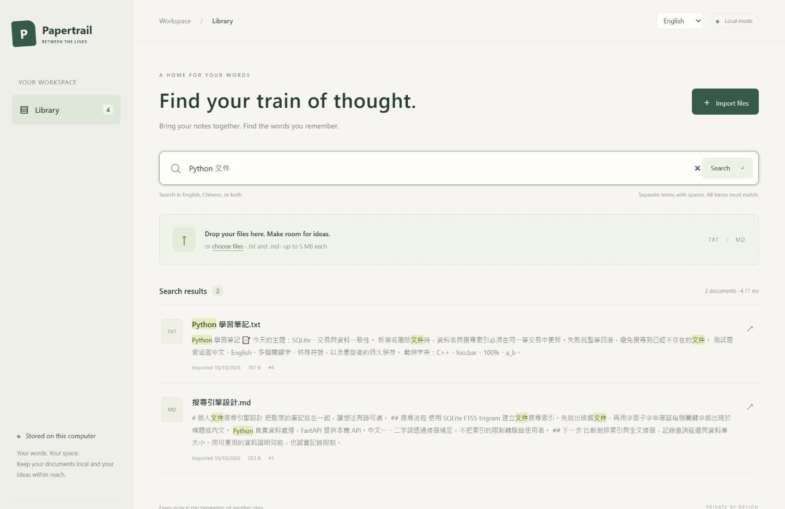
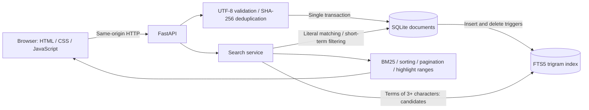

# Papertrail · Personal Document Search

**English** | [繁體中文](README.zh-TW.md)

A local document search engine built with Python, FastAPI, and SQLite FTS5. Import TXT and Markdown files, search English and Chinese text, and preview matching passages with highlighted keywords. The interface uses HTML, CSS, and vanilla JavaScript. No Node build step, account, or external API is required.



## Getting started on Windows

Requires Python 3.11 or later and SQLite with FTS5 trigram support (SQLite 3.34 or later). Verified on Windows 10 with Python 3.14.0 and SQLite 3.50.4.

Open PowerShell in the project directory:

```powershell
python -m venv .venv
.\.venv\Scripts\python.exe -m pip install -r requirements-lock.txt
.\start.ps1
```

Open **http://127.0.0.1:8765**. Press `Ctrl+C` to stop the server. Initial dependency installation requires internet access; importing and searching documents runs locally afterward. If the project's virtual environment and dependencies already exist, run `start.ps1` directly.

Alternatively, start the server without the PowerShell script:

```powershell
.\.venv\Scripts\python.exe -m uvicorn app:app --host 127.0.0.1 --port 8765
```

If the port is in use, run `start.ps1 -Port 8766`. Keep the server bound to `127.0.0.1`: this version has no authentication and is intended for local use.

`requirements.txt` lists direct dependencies; `requirements-lock.txt` records the complete package versions used for verification. Documents are stored in `data/documents.sqlite3` inside the project, regardless of the directory from which the server starts. Set `DOCUMENT_SEARCH_DB` to use another database path.

## Using Papertrail

Use the **Language / 語言** menu in the upper-right corner to switch between **English** and **繁體中文**. Your browser remembers the selection for the same origin across reloads and visits. The application's initial default is Traditional Chinese; this README defaults to English. Labels, dates, import results, errors, and deletion prompts support both languages.

Switching languages preserves the current search text and page. Document contents remain unchanged, and both modes support mixed English/Chinese searches. If browser storage is unavailable, switching still works for the current page, but the preference will not persist.

The English interface has been checked for language switching, preference persistence, bilingual queries, highlighted previews, duplicate imports, and file-format errors.

1. Drag the three files from `samples/` into the import area, or select them using **Import files**.
2. Search for `Python 文件`. Results must contain **every** term in the filename or body; different terms may match different fields.
3. Select a filename to open the full preview. Matches are highlighted; Markdown and HTML remain plain text.
4. Select **Delete document** in the preview and confirm to remove it from the library and index. The original file is untouched.
5. Clear the query or select **Library** to browse all documents. Press `/` to focus search and `Esc` to close the preview.

Results are paginated at 20 documents per page. Files must use UTF-8 or UTF-8 with BOM and must not exceed **5 MiB (5 × 1024 × 1024 bytes, labeled 5 MB in the interface)**. Blank documents, NUL characters, unsupported formats, and undecodable content are rejected. Batch imports report each file separately; a validation failure for one file does not prevent the others from being processed.

Deduplication uses SHA-256 of decoded text after removing a UTF-8 BOM. Identical content is skipped even under a different filename; different content with the same filename is stored separately. Different line endings count as different content. Files are not automatically overwritten. The database stores text and metadata without making a separate copy of the original file.

## Architecture and search design



- `app.py`: HTTP API, upload validation, local-origin checks, and static asset serving.
- `search_engine.py`: persistence, index maintenance, matching, ranking, snippets, and highlights.
- `static/`: English/Traditional Chinese interface, batch uploads, search, pagination, previews, deletion, and error states.

### Matching rules

Queries are split on Unicode whitespace and duplicate terms are removed. English A–Z is converted to lowercase; other characters remain unchanged. Matching uses literal substrings, so `Python` also matches `CPython`. There is no semantic search, stemming, character-width conversion, Traditional/Simplified Chinese conversion, or Unicode normalization.

Terms containing at least three Unicode characters are safely quoted as literal FTS phrases and joined with `AND` to select candidates. Parameterized SQL then checks each term against the title and body using `instr()`, preserving the same semantics as a full scan. Characters and words such as `"`, `%`, `_`, `*`, and `OR` are treated literally rather than as user-supplied SQL or FTS operators.

FTS5 trigram full-text queries do not match terms shorter than three characters. One- and two-character terms therefore use `instr()` scanning. Mixed queries use longer terms to select indexed candidates before filtering short terms. A `case_sensitive 1` trigram index over explicitly lowercased fields keeps case handling consistent between indexed and scan paths. See the [SQLite FTS5 trigram documentation](https://www.sqlite.org/fts5.html#the_trigram_tokenizer).

### Ranking and highlighting

Queries containing longer terms use BM25 with title/body weights of 6:1; short terms only filter matches. Queries consisting entirely of short terms prioritize documents with more matching terms in the title. Ties are broken by descending import time and document ID. Empty queries use descending import time and ID.

Each snippet contains up to 240 characters, starting up to 60 characters before the earliest body match. Title-only matches show the beginning of the body. The full-document API returns all highlight ranges as **Unicode code point offsets in `[start, end)` form**. The frontend uses `Array.from()` to handle emoji correctly and merges overlapping ranges. Document content is rendered with text nodes and `<mark>` elements, never passed to `innerHTML`.

### Consistency and persistence

SQLite triggers update the document table and external-content FTS index in the same transaction on insert and delete. The database uses WAL mode. Restarting does not rebuild or clear it, and a UNIQUE constraint protects deduplication. To back up your library, stop the server and copy the entire `data/` directory.

## API

| Method | Endpoint | Input and response |
|---|---|---|
| POST | `/api/documents` | Multipart with repeated `files` fields; each entry in `results` includes `filename`, `status`, and `message`, plus `id` for imported or duplicate files |
| GET | `/api/documents?page=1` | Paginated documents and snippets, with `total`, `page`, `pages`, `page_size`, and `elapsed_ms` |
| GET | `/api/search?q=Python&page=1` | The same pagination structure, plus title/snippet highlight ranges and a `strategy` field |
| GET | `/api/documents/{id}?q=Python` | Full text, metadata, and title/body highlight ranges; 404 if missing |
| DELETE | `/api/documents/{id}` | Returns the `deleted` ID; 404 if missing |
| GET | `/openapi.json` | OpenAPI schema |

Queries are limited to 500 characters and page numbers must be at least 1. No matches or pages beyond the last page return an empty result array. Per-file validation failures use `status: error`. The service does not enable cross-origin CORS access and rejects mutation requests carrying another origin. All web assets are served locally.

## Tests and browser verification

```powershell
.\.venv\Scripts\python.exe -m pytest -q
```

The recorded validation run passed **30 tests**, covering mixed-language searches, short terms, special characters, title weighting, pagination, deduplication, UTF-8 BOM, the 5 MiB boundary, deletion, restart persistence, transaction rollback, highlight offsets, cross-origin rejection, and comparison with an independent reference implementation. Starlette's test client produced one AnyIO deprecation warning; it did not affect the results.

Browser checks covered multi-file uploads, duplicate imports, bilingual searches, full-text highlighting, deletion confirmation, updated results after deletion, and empty results. `<script>` and `` payloads remained text in the preview and did not become executable elements. Desktop (1440 px) and narrow-screen (390 px) layouts were checked without horizontal overflow.

## Reproducible benchmarks

```powershell
.\.venv\Scripts\python.exe benchmark.py --sizes 1000 10000 --repeats 10
```

The generator uses seed `20261010` and eight bilingual topics, producing roughly 1.1 KiB per document. Synthetic corpora are stored separately under `benchmark-data/` with a new database filename for each run, without touching the user's `data/` directory. Results are written to `benchmark-results.json`, including environment details, source size, corpus hashes, per-query hit counts, and result-set equality checks.

Use `--data-dir PATH` to choose the benchmark database directory and `--output PATH` to choose the report location. Corpus content and order are reproducible; timing and database bytes are not guaranteed to be identical across runs.

Recorded results on Windows / Python 3.14.0 / SQLite 3.50.4:

| Documents | Data + index build | Database size | Query group | Indexed path median / P95 | Scan median / P95 |
|---:|---:|---:|---|---:|---:|
| 1,000 | 0.360 s | 6.52 MiB | Terms of 3+ characters | 1.042 / 2.201 ms | 8.294 / 15.732 ms |
| 1,000 | — | — | Mixed long/short terms | 1.002 / 1.174 ms | 7.840 / 9.204 ms |
| 1,000 | — | — | One- and two-character terms | 8.055 / 9.822 ms | 8.123 / 9.828 ms |
| 10,000 | 3.949 s | 56.11 MiB | Terms of 3+ characters | 10.116 / 13.636 ms | 74.727 / 86.338 ms |
| 10,000 | — | — | Mixed long/short terms | 10.422 / 12.979 ms | 74.870 / 88.456 ms |
| 10,000 | — | — | One- and two-character terms | 76.366 / 94.979 ms | 72.027 / 93.436 ms |

Each query is checked for identical complete ID sets before warm-cache timing. Runs alternate method order and use one SQLite connection. P95 uses the nearest-rank method; samples are pooled within each query group. Measurements include candidate matching, literal verification, and ID ordering, **excluding BM25 ranking, snippets, HTTP, and browser rendering**. They are not end-to-end latency measurements.

All benchmark result sets matched. At 10,000 documents, the median for longer-term queries was about 7.4× faster with the index. Short-term queries use scanning in both paths; their differences reflect measurement variation, not index acceleration. These results describe a small synthetic corpus, warm caches, and specific hardware, rather than arbitrary real-world documents or cold-cache behavior.

## Tradeoffs and future work

This version targets a single-user local document library. Short terms require linear scans, and large documents with many highlights increase preview costs. PDF, OCR, semantic search, authentication, cloud deployment, document editing, and automatic folder monitoring are not included.

The project's main engineering contributions are consistent bilingual substring matching, transactional document/index maintenance, and reproducible performance measurements with correctness checks. Future work could add real-world corpus evaluation, background imports, incremental updates, and PDF text extraction.
