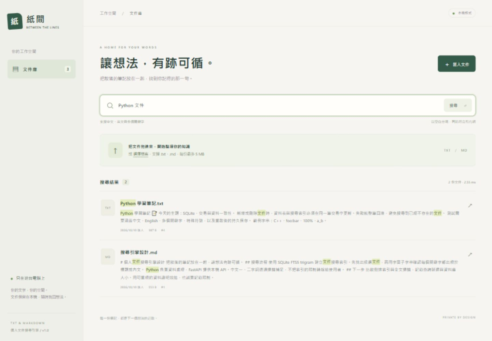
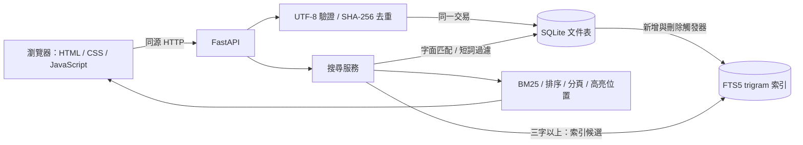

# 紙間 · 個人文件搜尋引擎

[English](README.md) | **繁體中文**

以 Python、FastAPI 與 SQLite FTS5 製作的本機文件搜尋工具。拖曳 TXT／Markdown，搜尋中英文關鍵字，查看高亮片段與全文。介面使用 HTML、CSS、原生 JavaScript，不需要 Node 建置、帳號或外部 API。



## 在 Windows 啟動

需要 Python 3.11 以上，以及支援 FTS5 trigram 的 SQLite（3.34 以上）。本次驗證環境為 Python 3.14.0、SQLite 3.50.4、Windows 10。

在此專案資料夾開啟 PowerShell：

```powershell
python -m venv .venv
.\.venv\Scripts\python.exe -m pip install -r requirements-lock.txt
.\start.ps1
```

開啟 **http://127.0.0.1:8765**，按 `Ctrl+C` 停止服務。首次安裝需要網路；安裝後，文件匯入與搜尋完全在本機執行。如果此機器已經保留專案的 `.venv`，直接執行 `start.ps1` 即可。

不執行 PowerShell 腳本也可以直接啟動：

```powershell
.\.venv\Scripts\python.exe -m uvicorn app:app --host 127.0.0.1 --port 8765
```

埠號被占用時使用 `start.ps1 -Port 8766`。請保留 `127.0.0.1` 綁定；此版本沒有登入機制，不適合直接公開到網路。

`requirements.txt` 記錄直接依賴；`requirements-lock.txt` 保存本次驗證的完整套件版本。程式啟動後預設將資料保存於專案內的 `data/documents.sqlite3`，與啟動時的工作目錄無關。可用 `DOCUMENT_SEARCH_DB` 環境變數指定其他資料庫路徑。

## 使用方式

右上角的 **Language / 語言** 選單可切換 **繁體中文 / English**。選擇保存在此瀏覽器的本機儲存空間，重新整理或再次開啟同一網址會沿用；首次使用預設繁體中文。介面、日期、匯入回報、錯誤與刪除確認都支援英文。切換語言不會清除搜尋文字或目前頁碼，也不會翻譯或修改文件內容；兩種模式都支援中英混合搜尋。如果瀏覽器禁止儲存，切換仍可使用，但不會跨次保存。

英文介面已驗證來回切換、重新整理後保留選擇、中英查詢、高亮預覽、匯入去重及格式錯誤訊息。

1. 將 `samples/` 中的三份範例文件拖進匯入區，或按「匯入文件」一次選取多份。
2. 搜尋 `Python 文件`：只有標題或內文包含 **全部** 關鍵字的文件會出現；各詞可以分別出現在標題與內文。
3. 點選檔名，開啟全文預覽。命中詞會高亮，Markdown 及 HTML 都保持純文字。
4. 在預覽視窗選擇「刪除文件」，經確認後移除資料及索引；原始檔案不受影響。
5. 清空搜尋或按「文件庫」查看全部文件。按 `/` 可快速聚焦搜尋框，`Esc` 關閉預覽。

每頁顯示 20 份文件。支援 UTF-8／UTF-8 BOM，每份最多 **5 MiB（5 × 1024 × 1024 bytes，介面簡稱 5 MB）**；拒絕空白文件、NUL 字元、其他格式及無法解碼的內容。批次匯入逐檔回報結果，單一檔案失敗不影響其他檔案。

依「去除 UTF-8 BOM 後的文字內容」計算 SHA-256 去重；相同內容即使檔名不同也會略過，同名不同內容則各自保存。換行不同視為不同內容，不自動覆蓋文件。資料庫保存文字與 metadata，不另外複製原始檔案。

## 架構與搜尋設計



- `app.py`：HTTP API、檔案驗證、本機來源檢查、靜態網頁服務。
- `search_engine.py`：持久化、索引維護、匹配、排序、摘要、高亮。
- `static/`：英文／繁體中文介面、批次上傳、搜尋、分頁、預覽、刪除及錯誤狀態。

**匹配規則**

查詢以 Unicode 空白切分並去除重複詞。英文 A–Z 轉為小寫，其他字元保留原樣，採字面子字串比對；`Python` 可以匹配 `CPython`。不做語意搜尋、英文詞幹還原、全半形轉換、繁簡轉換或 Unicode 正規化。

三個 Unicode 字元以上的詞會被安全包成 FTS 字面片語，以 `AND` 合併取得候選。然後用參數化 SQL 的 `instr()` 逐詞核對標題及內文，維持與全文掃描相同的語意。`"`、`%`、`_`、`*`、`OR` 等都當作一般字元或一般詞，使用者不能注入 FTS 運算子或 SQL。

FTS5 trigram 不會匹配少於三字的全文查詢，所以一、二字詞採 `instr()` 掃描；長短混合先用長詞索引，再過濾短詞。使用 `case_sensitive 1` 的 trigram 索引搭配自行產生的小寫欄位，讓大小寫與掃描路徑的規則一致。參考 [SQLite FTS5 trigram 文件](https://www.sqlite.org/fts5.html#the_trigram_tokenizer)。

**排序與高亮**

有長詞時按 BM25 排序，標題與內文權重為 6:1；短詞只參與匹配過濾。全部都是短詞時，優先顯示標題命中詞數較多的文件。分數相同時依匯入時間及 ID 遞減排序。空查詢依匯入時間及 ID 遞減排序。

每筆摘要包含最多 240 個字元，從最早的內文命中處前方最多 60 字開始；只有標題命中時顯示內文開頭。全文 API 回傳所有命中區間。高亮區間以 **Unicode code point 的 `[start, end)`** 表示，前端使用 `Array.from()` 處理 emoji，並合併重疊範圍。DOM 僅透過文字節點與 `<mark>` 建立，不將文件內容送入 `innerHTML`。

**一致性**

文件表與 external-content FTS 索引透過 SQLite 觸發器在同一交易新增／刪除，採 WAL 模式。重啟不重建或清空資料庫；去重由 UNIQUE 約束保護。備份時先停止服務，再複製 `data/` 整個資料夾。

## API

| 方法 | 路徑 | 輸入與回傳 |
|---|---|---|
| POST | `/api/documents` | multipart，重複 `files` 欄位；`results` 逐檔回傳 `filename`、`status`、`message`，成功或重複時包含 `id` |
| GET | `/api/documents?page=1` | 分頁文件與摘要，含 `total`、`page`、`pages`、`page_size`、`elapsed_ms` |
| GET | `/api/search?q=Python&page=1` | 相同分頁結構；每筆含標題高亮區間及摘要高亮區間，另回傳 `strategy` |
| GET | `/api/documents/{id}?q=Python` | 全文、metadata、內文與標題高亮區間；不存在回傳 404 |
| DELETE | `/api/documents/{id}` | 回傳 `deleted` ID；不存在回傳 404 |
| GET | `/openapi.json` | OpenAPI 結構定義 |

查詢最長 500 字元，頁碼必須大於等於 1；無結果及超出最後一頁回傳空陣列。批次中個別檔案驗證失敗用 `status: error` 回報。服務未提供跨來源 CORS 存取，會拒絕跨來源修改請求；所有網頁資產由本機提供。

## 自動測試與操作驗收

```powershell
.\.venv\Scripts\python.exe -m pytest -q
```

本次 **30 項測試通過**，包含中英混合、短詞、特殊符號、標題權重、分頁、重複文件、UTF-8 BOM、5 MiB 邊界、刪除、重啟持久性、交易回滾、高亮偏移、跨來源拒絕及與獨立參考實作比對。相依套件 Starlette 的測試工具產生一項 AnyIO 棄用提示，不影響測試結果。

已使用真實瀏覽器驗證多檔上傳、重複匯入、中英查詢、全文高亮、刪除確認、刪除後結果更新及空結果狀態。安全測試文件中的 `<script>` 與 `` 在預覽中皆為文字，未生成可執行元素。桌面 1440 px 與窄螢幕 390 px 版面均檢查，沒有水平溢出。

## 可重現效能評測

```powershell
.\.venv\Scripts\python.exe benchmark.py --sizes 1000 10000 --repeats 10
```

資料生成器固定 seed `20261010`，涵蓋八種中英混合主題，每份約 1.1 KiB。合成資料保存在獨立的 `benchmark-data/` 資料庫；每次使用新檔名，不接觸使用者的 `data/`。結果寫入 `benchmark-results.json`，包含環境資訊、原始資料量、語料雜湊、各查詢命中數與結果集合一致性。

若要將評測資料保存在其他位置，可加上 `--data-dir PATH`；用 `--output PATH` 指定報告。語料內容及順序可重現，執行時間與資料庫位元組內容不保證完全相同。

本次 Windows / Python 3.14.0 / SQLite 3.50.4 實測：

| 文件數 | 建立資料與索引時間 | 資料庫大小 | 查詢類別 | 索引路徑 median / P95 | 掃描 median / P95 |
|---:|---:|---:|---|---:|---:|
| 1,000 | 0.360 s | 6.52 MiB | 三字以上 | 1.042 / 2.201 ms | 8.294 / 15.732 ms |
| 1,000 | — | — | 長短混合 | 1.002 / 1.174 ms | 7.840 / 9.204 ms |
| 1,000 | — | — | 一、二字 | 8.055 / 9.822 ms | 8.123 / 9.828 ms |
| 10,000 | 3.949 s | 56.11 MiB | 三字以上 | 10.116 / 13.636 ms | 74.727 / 86.338 ms |
| 10,000 | — | — | 長短混合 | 10.422 / 12.979 ms | 74.870 / 88.456 ms |
| 10,000 | — | — | 一、二字 | 76.366 / 94.979 ms | 72.027 / 93.436 ms |

每組查詢先核對完整 ID 集合一致，再暖機計時；重複時交替兩種方法的先後順序，使用同一 SQLite connection。P95 為 nearest-rank 計算，數值按同類別查詢合併統計。測量包含候選匹配、字面核對與 ID 排序，**不包含 BM25、摘要、HTTP 或瀏覽器渲染**，所以不是端到端延遲。

所有評測查詢的結果集合一致。10,000 份資料的長詞查詢中位數約快 7.4 倍；短詞的兩條路徑實際都使用掃描，差異是量測波動，不宣稱有索引加速。此為小型合成語料、暖快取及特定硬體下的結果，不代表任意真實文件或冷快取情境。

## 取捨與後續方向

第一版適合單人本機文件庫。短詞仍需線性掃描；很大的文件與大量高亮會增加預覽成本。沒有 PDF、OCR、語意搜尋、登入、雲端部署、文件編輯或資料夾自動監控。

履歷可聚焦三項工程成果：中英子字串搜尋的一致語意、交易化的文件／索引維護，以及可重現且核對正確性的效能評測。未來可加入真實語料評測、背景匯入、增量更新與 PDF 文字抽取。
